# 🦀 CRAB PACK

### Creative Lab Pack

**Seriously Creative, Pure Crap.**

We take code seriously. Our ideas? That's a different story.

CRAB PACK is a creative development lab where serious engineering meets ridiculous ideas. We build software, experiment with technology, and turn questionable ideas into actual projects.

## 🔬 What We Do

- **Build** — Develop useful software with care and attention to detail.
- **Experiment** — Explore unusual ideas and see where they lead.
- **Create** — Turn questionable ideas into surprisingly real projects.

## 🛠️ Our Projects

We build things that may start as a joke but don't necessarily end as one.

Explore our repositories to see what we're working on.

## 🥞 The Crab Pack Lore

Creative Lab → Crab → Crap → Crêpe.

A perfectly reasonable naming process. Don't ask questions.

Our name is **CRAB PACK**. Our fans are **Crêpes**. And yes, the pun is intentional.

## 📫 Get in Touch

Have an idea, a question, or something you'd like to build?

Open an issue in one of our repositories, or email [crabpack.team@gmail.com](mailto:crabpack.team@gmail.com).

---

**Seriously Creative, Pure Crap.** 🦀
